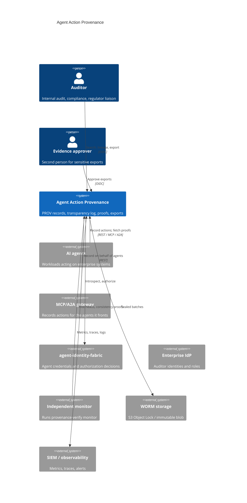
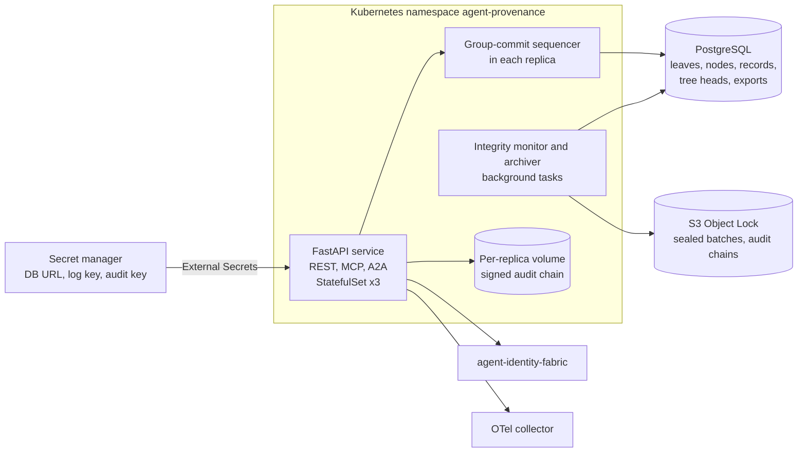
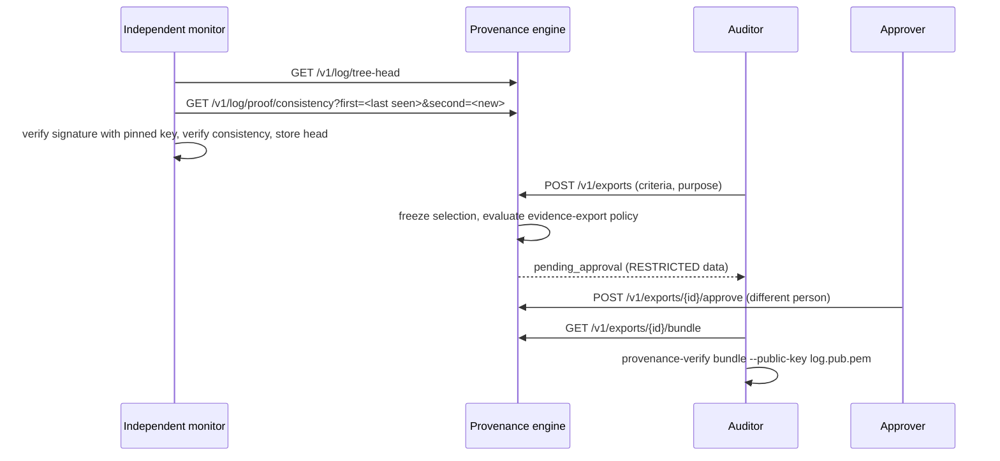
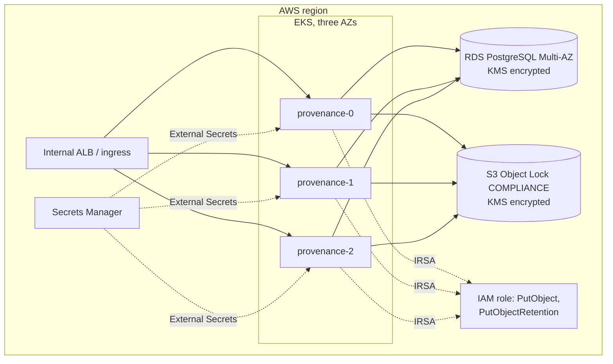

# Architecture

## Business problem

Enterprises are letting AI agents act on regulated systems: creating clinical
tasks, approving refunds, changing infrastructure, editing GxP records. When
something goes wrong, or when an auditor asks, three questions have to be
answered with evidence rather than recollection:

1. **What did the agent do, and why?** The decision, the model and prompt
   that produced it, and the exact evidence it relied on.
2. **Was it allowed to?** The policy decision, the policy version, and any
   human approval, with timestamps that show the approval came first.
3. **Can we trust the record itself?** Logs written by the same platform that
   ran the agent can be edited by anyone with database access.

Application logs answer none of these reliably. This engine records each
action as a W3C PROV document, checks it against governance rules, and seals
it into an append-only Merkle log whose state is signed and independently
checkable, so altering any record, or quietly dropping one, is detectable by
anyone holding the log's public key.

## System context (C4 level 1)



## Containers (C4 level 2)



## Components (C4 level 3)

| Layer | Module | Responsibility |
|---|---|---|
| API | `api.routes`, `api.mcp`, `api.a2a`, `api.app` | REST contract, MCP tools, A2A card and JSON-RPC, correlation IDs, OAuth-style errors, metrics, background loops |
| Application | `application.service.ProvenanceService` | Record, prove, verify, lineage, export, integrity check, archive; audit every outcome |
| Application | `application.sequencer.BatchSequencer` | Group commit: batches concurrent records into one transaction and one signed tree head |
| Domain | `domain.merkle` | RFC 6962 hashing, proof planning and assembly, RFC 9162 verification, in-memory tree |
| Domain | `domain.prov` | PROV-JSON builder and constraint validator |
| Domain | `domain.governance` | Deterministic governance findings |
| Domain | `domain.verification` | Offline verification of proofs, records and bundles (shared with the CLI) |
| Domain | `domain.models`, `domain.log`, `domain.exports` | Records, tree heads and proofs, export requests |
| Security | `security.signing`, `security.keys` | Ed25519 tree-head signer, key loading |
| Security | `security.authorization`, `security.jwks` | Fabric and local-policy agent authorizers, auditor OIDC |
| Integrations | `integrations.identity_fabric` | Typed client: `/oauth2/token`, `/oauth2/introspect`, `/v1/authorize` |
| Infrastructure | `infrastructure.ledger`, `database`, `exports`, `archive` | SQL ledger, schema, export store, WORM archives |
| Runtime | `runtime.container` | Composition root built from settings |
| CLI | `cli` | `provenance-verify` |

## Data flow: Decision → Evidence → Authorization → Audit Record

```mermaid
sequenceDiagram
  participant A as Agent
  participant P as Provenance engine
  participant F as Identity fabric
  participant D as PostgreSQL
  participant W as WORM archive
  A->>P: POST /v1/records (decision, evidence digests, authorization, outputs)
  P->>F: introspect credential; authorize provenance:record:write
  F-->>P: active, allow (policy digest)
  P->>P: idempotency check (agent, action_id)
  P->>P: build PROV document, validate constraints, governance findings
  P->>P: queue record for group commit
  P->>D: one transaction: lock log_state, append leaves + nodes + records, sign tree head
  D-->>P: committed batch with audit paths
  P->>P: append signed audit event (record digest, leaf index, root)
  P-->>A: 201 receipt: record ID, findings, signed tree head, inclusion proof
  P--)W: archiver writes sealed batch (Object Lock, COMPLIANCE)
```

## Monitoring and auditing



## The transparency log

* **Leaf** = `SHA-256(0x00 || canonical JSON of the ProvenanceRecord)`. The
  record contains the submission, the PROV document and the governance
  findings, so all of them are covered.
* **Nodes**: every perfect, aligned subtree hash is stored once
  (`merkle_nodes(level, idx)`). Any root or proof is a left-to-right sequence
  of such subtrees, so it takes one indexed query and `O(log n)` rows.
* **Appends**: one writer at a time across all replicas (`SELECT … FOR UPDATE`
  on `log_state`). A batch either commits completely with its signed tree head
  or not at all.
* **Tree heads**: Ed25519 over canonical JSON of
  `{version, log_id, tree_size, root_hash, timestamp}`; `log_id` is the
  SHA-256 of the public key's SubjectPublicKeyInfo.
* **Self-monitoring**: every minute each replica re-derives the latest signed
  root from stored nodes, re-hashes the latest batch's records, and proves
  consistency with the last head it verified.

## Deployment view (AWS reference)



Replicas spread across zones; the PDB keeps two available during voluntary
disruption; RDS runs Multi-AZ with 14-day PITR. Azure (PostgreSQL Flexible
Server, Key Vault, immutable blob container, Workload ID) and GCP (Cloud SQL,
Cloud KMS, retention-locked bucket, Workload Identity) are provided in
`deployments/terraform/` with the same shape.

## Data

| Store | Data | Classification | Retention |
|---|---|---|---|
| PostgreSQL `records` | Sealed records (digests and metadata of evidence, never content) | As high as the evidence labels, typically CONFIDENTIAL | 7 years |
| PostgreSQL `leaves`, `merkle_nodes`, `tree_heads` | Hashes and signed heads | INTERNAL | Life of the log |
| PostgreSQL `exports` | Export requests, frozen selections, approvals | CONFIDENTIAL | 7 years |
| WORM archive | Sealed batches, audit chains | As records | 7 years, COMPLIANCE lock |
| Audit chains (per replica) | Who recorded, read, exported, approved | CONFIDENTIAL | 7 years via WORM |
| Log and audit keys | Ed25519 private keys | SECRET | Rotated per key-rotation runbook |

Evidence content is never stored: only URIs and SHA-256 digests. Bearer
credentials are never persisted or logged.

## CI/CD

GitHub Actions (`.github/workflows/ci.yml`) on every push and pull request:
lint and format, `mypy --strict`, bandit, contract drift, all test suites with
a 90% branch-coverage gate on Python 3.12 and 3.13; PostgreSQL integration;
Helm lint, render, required-value check and kubeconform; Terraform fmt and
validate for three clouds; Trivy config scan; image build, container smoke
test, Trivy image scan, Syft SBOM and Grype gate; Semgrep. Tags `v*.*.*`
(`release.yml`) rerun the gate, publish the image with SLSA provenance and
attestation, push the Helm chart to GHCR as OCI, and publish a GitHub release
with the SBOM.
